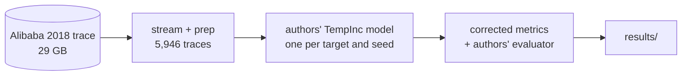

# SpikeCheck

**Does forecasting CPU spikes actually help cloud provisioning, and how would you know?**

Agulló et al. (2025, *Future Generation Computer Systems* 170, 107833) propose changing what a forecaster is trained to predict so that it anticipates CPU spikes, and report that this doubles spike-prediction scores. SpikeCheck audits how those scores are computed, rebuilds the experiment on the public Alibaba 2018 cluster trace, and tests what actually makes the method work.

**[Read the project story](docs/project-story.md)**: the problems, decisions and fixes behind SpikeCheck, in SOART format.

## How it works

1. **Audit the metrics.** The paper's over-provisioning metric divides by about 1e-10 and its spike precision rewards forecasts that lag ([review](docs/review.md), [ADR-001](docs/adr/001-corrected-metrics.md)).
2. **Rebuild the data.** Stream the 29 GB Alibaba container trace into 5-minute steps and select 5,946 long-running containers ([ADR-005](docs/adr/005-rebuilt-preprocessing.md)).
3. **Train the authors' model on different targets.** Same model, inputs and data; only what it's asked to predict changes ([ADR-004](docs/adr/004-change-one-thing-at-a-time.md)).
4. **Score fairly.** Allocations take effect after a 5, 15 or 30-minute delay ([ADR-002](docs/adr/002-score-under-actuation-delay.md)), and forecasters are compared at equal over-provisioning with three seeds each ([ADR-003](docs/adr/003-compare-at-equal-over-provisioning.md)).

## Key findings

| Finding | Evidence |
|---|---|
| The paper's headline reproduces on its own evaluator | Spike F1 0.42 → 0.65 for the TempInc model (paper: 0.27 → 0.64) |
| Its over-provisioning numbers are an artefact | Every forecaster scores 10¹⁵ to 10¹⁷, even repeating the last value |
| With no actuation delay, a plain classifier read at an upper quantile is as good or better | Same recall as the proposed method with about 30% less over-provisioning |
| With a 15-minute delay, the proposed method wins, because its target looks ahead | Spike coverage 0.57 against 0.44 at the same over-provisioning |
| The look-ahead is what helps; holding the allocation after a spike hurts | A look-ahead-only target beats the paper's at every budget, in all three seeds: +8 points of coverage and 19% less throttling at slack 0.6 |
| The look-ahead must be at least as long as the delay | A perfect forecaster of the paper's 25-minute target covers 99.6% of spikes at a 5-minute delay but only 28% at 30 minutes |

Details and every caveat: [replication write-up](docs/replication.md).

## Status

| Part | State |
|---|---|
| Review of the paper | Done |
| First replication (paper reproduced, quantile readout) | Done |
| Horizon vs hold, three seeds | Done |
| 30-minute look-ahead, three seeds | Running |
| Strategy 2 (altered loss), calibration, spike types, time and cluster holdouts | [Backlog](BACKLOG.md) |

## Architecture

Six diagrams in [docs/architecture.md](docs/architecture.md): the data pipeline, how a forecast becomes a score, the paper's metrics against the corrected ones, which time steps each target covers, the experiment grid, and the TempInc model.



## Key decisions

| ADR | Decision |
|---|---|
| [001](docs/adr/001-corrected-metrics.md) | Score with corrected metrics, and keep the authors' evaluator alongside |
| [002](docs/adr/002-score-under-actuation-delay.md) | Score forecasts under actuation delay |
| [003](docs/adr/003-compare-at-equal-over-provisioning.md) | Compare at equal over-provisioning, with seed-paired differences |
| [004](docs/adr/004-change-one-thing-at-a-time.md) | Change one thing at a time: only the target varies |
| [005](docs/adr/005-rebuilt-preprocessing.md) | Rebuild the preprocessing, keeping the authors' choices where known |
| [006](docs/adr/006-data-and-upstream-outside-the-repo.md) | Keep the data and the authors' code out of the repo; pin their commit |
| [007](docs/adr/007-true-date-history.md) | Date commits by when each file's content actually existed |

## Repository layout

```
scripts/      pipeline: stream_alibaba, prep, train, baselines, metrics, evaluation, runners
results/      replication/, horizon/ (and horizon30/ when it finishes): CSV, JSON, plots
docs/         review, replication write-up, architecture diagrams, project story, ADRs
data/         downloaded and generated data, models (not committed)
upstream/     the authors' code at a pinned commit (not committed)
LOG.md        one line per session
NEXT.md       the next single task
BACKLOG.md    parked ideas
```

## Running it

Python 3.12, about 1 GB of free disk, and a few hours.

```bash
scripts/setup.sh       # authors' code at commit 98f0d51, plus packages
scripts/get_data.sh    # stream and prepare the trace (about 2.5 h at 4 MB/s)
scripts/run_all.sh     # first replication, about 1.5 h
```

The horizon experiments use `scripts/run_seeds.sh` and `scripts/overnight.sh`; see the [replication write-up](docs/replication.md#reproduce). Training a model takes about 30 minutes and up to 2.5 GB of memory on an 8 GB laptop.

## Sources

- Agulló, F., Gutierrez-Torre, A., Torres, J., Berral, J. Ll. (2025). Enhancing the output of time series forecasting algorithms for cloud resource provisioning. *Future Generation Computer Systems* 170, 107833. https://doi.org/10.1016/j.future.2025.107833
- Authors' code: https://github.com/FerranAgulloLopez/ResourceForecasting (Apache-2.0)
- Alibaba cluster trace 2018: https://github.com/alibaba/clusterdata/tree/master/cluster-trace-v2018
