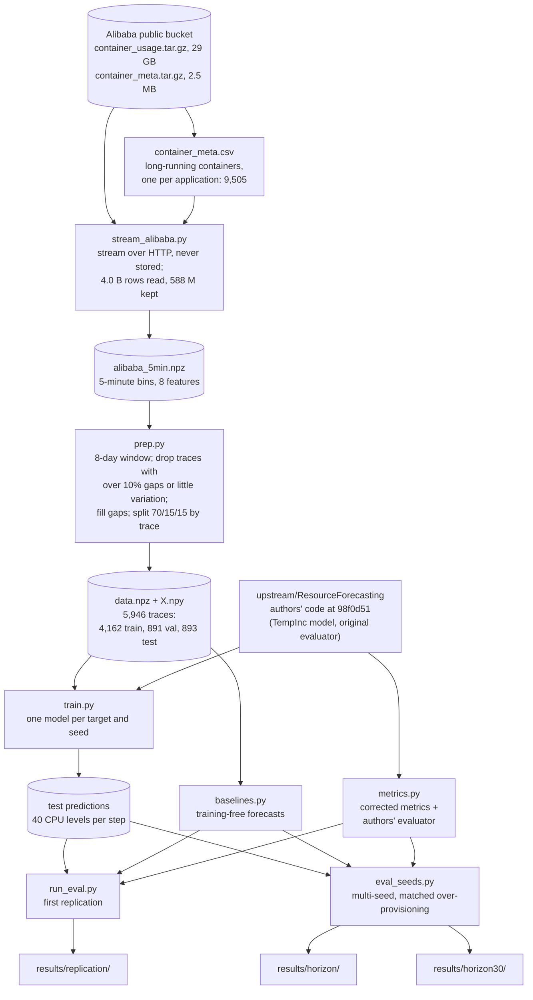
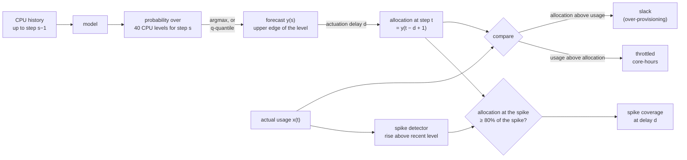
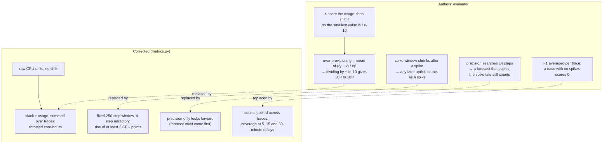
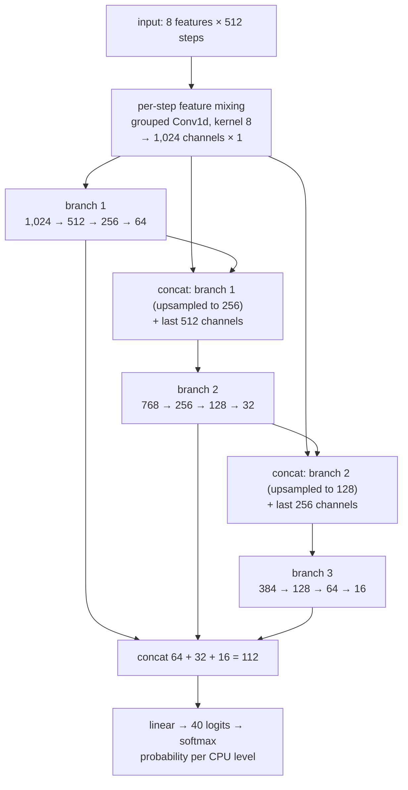

# SpikeCheck architecture diagrams

## Summary (SOART)

- **Scenario:** SpikeCheck re-examines Agulló et al. (2025), a method for forecasting CPU spikes so that cloud resources can be added before a spike arrives. It audits the paper's metrics, replicates the method on the Alibaba 2018 trace and tests what makes it work.
- **Obstacle:** to follow the findings, a reader needs four things at once: where the numbers come from, how a forecast becomes a score, what the paper's metrics get wrong, and what each experiment compared.
- **Action:** one diagram for each of those questions, drawn from the scripts as they are now. Solid lines and boxes are done; dashed ones are planned.
- **Result:** every number in the write-up can be traced back to the raw trace, and the main finding (looking ahead helps, holding after a spike hurts) has its own picture.
- **Troubleshooting:** a diagram is only useful while it matches the code, so these get updated at the end of every milestone.

Contents:

1. [Data pipeline](#1-data-pipeline)
2. [From forecast to score](#2-from-forecast-to-score)
3. [The paper's metrics and the corrected ones](#3-the-papers-metrics-and-the-corrected-ones)
4. [Target windows](#4-target-windows)
5. [Experiment grid](#5-experiment-grid)
6. [The TempInc model](#6-the-tempinc-model)

---

## 1. Data pipeline

Every number in the repo comes out of this chain. The raw trace and everything made from it live in `data/`, which is never committed; only the results at the end are tracked.

`scripts/get_data.sh` runs the first half, from download to `data.npz`. `scripts/run_all.sh` and `scripts/run_seeds.sh` do the training, and `eval_seeds.py` and `run_eval.py` write the results.

## 2. From forecast to score

The model forecasts each 5-minute step, the forecast becomes a CPU allocation, and the allocation only takes effect after the actuation delay. The score compares that allocation with what the container actually used.

Everything turns on the delay. With d = 1, the forecast for the next step is used straight away; with d = 3 (15 minutes) or d = 6 (30 minutes), the allocation in force was decided that many steps earlier. Slack is summed over the whole test set and divided by total usage, so the metric never divides by one small value.

## 3. The paper's metrics and the corrected ones

Both evaluators score the same forecasts. The left column is what the authors' code does, and the right is what `metrics.py` does instead.

In this diagram a dashed arrow means "replaced by", not "planned". The authors' evaluator still runs, unchanged, next to the corrected one, so the results include both sets of numbers.

## 4. Target windows

Each target answers "what should the model predict for step t?" differently. The decision is made at the end of step t−1, so step t and everything after it is still in the future. ■ marks the steps whose maximum becomes the target.

| Target | t−6 | t−5 | t−4 | t−3 | t−2 | t−1 | **t** | t+1 | t+2 | t+3 | t+4 | t+5 |
|---|---|---|---|---|---|---|---|---|---|---|---|---|
| cbase: next value | | | | | | | ■ | | | | | |
| proposed (Strategy 1): hold + look-ahead | ■ | ■ | ■ | ■ | ■ | ■ | ■ | ■ | ■ | ■ | ■ | |
| fwdmax: 25-min look-ahead | | | | | | | ■ | ■ | ■ | ■ | ■ | |
| fwdmax6: 30-min look-ahead | | | | | | | ■ | ■ | ■ | ■ | ■ | ■ |

Steps t−6 to t−1 are already known when the forecast is made, so the paper's target spends part of its prediction on keeping the allocation high after a spike has passed. fwdmax keeps only the look-ahead. With a 15-minute delay (3 steps), the allocation in force during a spike was forecast 3 steps earlier, so a target has to reach at least 2 steps ahead to cover it. With a 30-minute delay (6 steps) it has to reach 5 steps ahead, and only fwdmax6 does. The results agree: at a 30-minute delay and slack 0.8, fwdmax6 covers 0.74 of spikes, against 0.59 for fwdmax and 0.56 for the paper's target.

This one is a table rather than a Mermaid chart because Mermaid has no grid layout for time steps.

## 5. Experiment grid

What changed between runs, what stayed the same, and how two forecasters are compared fairly.

```mermaid
flowchart LR
    subgraph FIXED["Held fixed"]
        direction TB
        D["same 5,946 traces and split"]
        I["same 8 inputs, 512 past steps"]
        MOD["same TempInc model and training settings"]
    end
    subgraph VARIED["Varied"]
        direction TB
        T["target:<br/>cbase, proposed, proposed_full,<br/>fwdmax, fwdmax6"]
        S["seed: 0, 1, 2"]
        Q["readout: argmax, or<br/>quantile 0.1 … 0.995"]
        B["training-free baselines:<br/>persistence, rolling max,<br/>seasonal max, rolling percentile"]
    end
    subgraph SCORE["Scored"]
        direction TB
        DL["at delays of 5, 15 and 30 minutes"]
        MS["at equal over-provisioning:<br/>each quantile curve read at<br/>slack 0.4 … 1.5"]
        PD["seed-paired differences<br/>(seed k against seed k)"]
    end
    FIXED --> VARIED --> SCORE
```

Any forecaster can cover more spikes by asking for more CPU, so forecasters are compared at equal over-provisioning: each model's quantile curve is read at the same slack. Pairing seeds then keeps training noise out of the differences.

## 6. The TempInc model

The authors' classifier, used as published. It takes the last 512 steps of 8 features and outputs a probability for each of 40 CPU levels, 2.5 CPU points apart.

After the first layer the sequence has length 1, so the 1×1 convolutions in each branch behave like fully connected layers. In practice TempInc is a multi-branch network over the 512 time steps, not a convolution that slides along them. Training uses Adam with a learning rate of 0.01, 200 random windows per training trace per epoch, and early stopping on validation loss.
