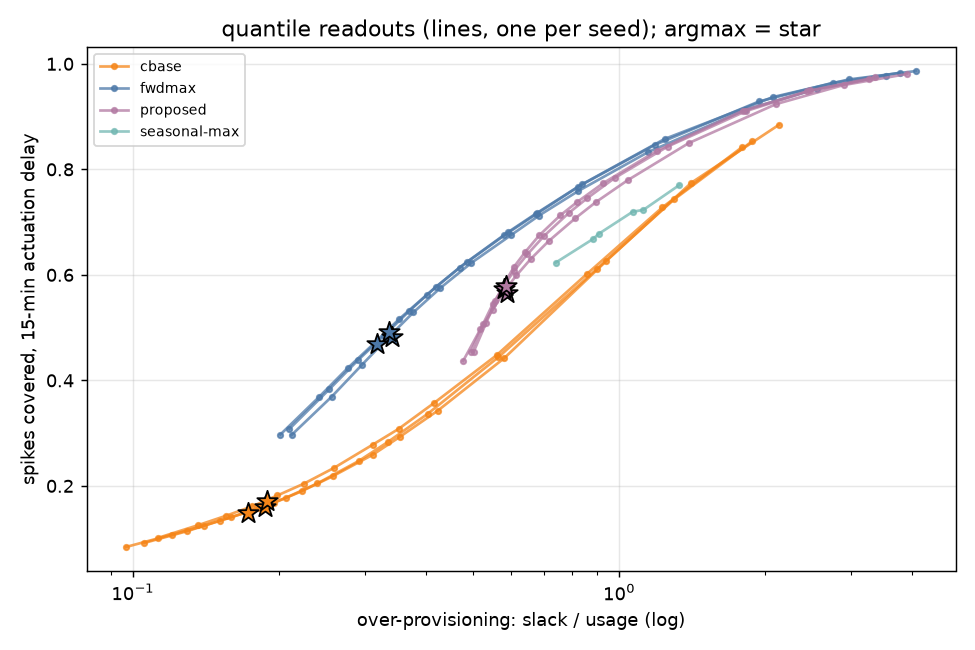
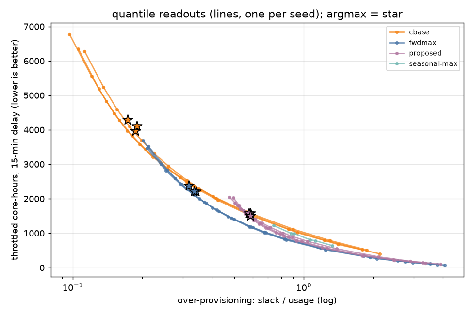
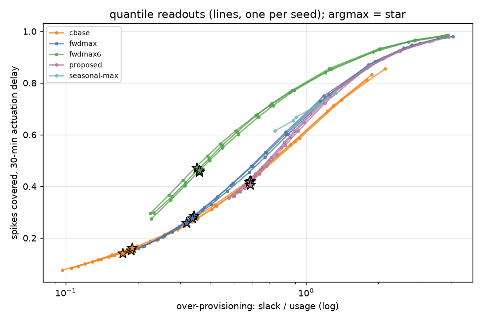

# Agulló et al. (2025) on the Alibaba trace: corrected metrics, rolling-max baselines and quantile readout

Run on 2026-10-22 as a follow-up to the [critical review](review.md). It tests opportunities #2 and #3 and audit items D1 to D6 and C3 to C4. Every result was regenerated from the committed scripts on 2026-10-28 (see [Rebuild](#rebuild-every-result-regenerated-from-the-committed-scripts-28-october-2026)).

## What was run

| Step | What | Notes |
|---|---|---|
| Data | Alibaba 2018 `container_usage` (29.2 GB, 4.0 billion rows), streamed from Alibaba's public bucket and summed into 5-minute bins without storing the raw file | `scripts/stream_alibaba.py` |
| Selection | Long-running containers (present at t=0, never stopped), one at random per `app_du`: 9,505. Then at most 10% empty bins: 8,833. Then max minus mean of at least 5 CPU points: 5,946 traces (the paper had 5,168) | The paper's preprocessing isn't public, so this is a reconstruction (`scripts/prep.py`). Usage data runs from about 86,400 s to 777,600 s, so the 8-day window is bins 288 to 2591. |
| Split | Random by trace, 70/15/15, seed 0: 4,162 / 891 / 893 test traces. Scaling fitted on training traces only | Same scheme as the paper (random by trace, same time period) |
| Models | The authors' own TempInc class (imported from their repo), lag 512, 8 features, 40 CPU bins, Adam with learning rate 0.01 and amsgrad, decoding to the upper bin edge as in their code | cbase: target x[t]. proposed: target max(x[t−6..t+4]), the paper's Strategy 1 target as implemented. proposed_full: also the paper's input transform. Inputs are otherwise identical, so only the target changes. |
| Training | Early stopping on validation cross-entropy (patience 3), 60-minute cap, 200 random windows per training trace per epoch, one seed | Best epochs: cbase 4, proposed 11, proposed_full 6 |
| Baselines | Persistence; rolling max (W from 3 to 288, margin 0, 10 or 25%), which is Autopilot's peak recommender; seasonal max (rolling max or the same time yesterday ±30 min, whichever is higher); rolling 24-hour percentile; two oracles that see the future | `scripts/baselines.py` |
| Readout | The classifier's softmax read at a quantile q from 0.5 to 0.99 instead of its most likely class. No retraining | `train.decode` |
| Metrics | Corrected metrics in raw CPU units (`scripts/metrics.py`), plus the authors' own `evaluation.py`, run unchanged | Corrected metrics: slack divided by usage; spike recall with the paper's window and band; forward-only precision; spike coverage and throttled core-hours with an actuation delay of d = 1, 3 or 6 steps (5, 15 or 30 minutes) |

## Results

### 1. The paper's headline reproduces, and so does its metric artefact
On the authors' own evaluator, TempInc's spike F1 goes from 0.41 (cbase) to 0.68 (proposed) on our data. The paper reports 0.27 to 0.64 for Alibaba TempInc (Table 3).

The same evaluator gives every forecaster an over-provisioning between 4×10¹⁵ and 7×10¹⁶, including persistence. That confirms D1: the shift to 1e-10 sets those numbers, not the forecasts.

### 2. On the paper's own recall measure, a quantile readout beats Strategy 1 without retraining
Compared at matched over-provisioning (proposed argmax has slack/usage 0.578):

| Forecaster | slack/usage | spike recall (paper window) | F1 with forward-only precision |
|---|---|---|---|
| proposed argmax (Strategy 1) | 0.578 | 0.625 | 0.264 |
| cbase, read at q = 0.95 | 0.551 | 0.655 | 0.241 |
| cbase, read at q = 0.9 | 0.407 | 0.569 | 0.314 |
| best rolling max within budget | 0.567 | 0.353 | 0.193 |

Bootstrap 95% intervals over test traces (500 resamples):
- cbase at q=0.95 minus proposed: recall [+0.020, +0.040], slack [−0.047, −0.007]. Higher recall with slightly less over-provisioning.
- cbase at q=0.9 minus proposed: recall [−0.066, −0.048], slack [−0.193, −0.150]. Much less over-provisioning, but lower recall.

Between those two quantiles, cbase reaches the proposed method's recall at a slack of about 0.50, which is 14% less. With three seeds and a finer quantile grid (the horizon follow-up below), the saving is 14 to 29%.

So on the paper's own recall window, a plain cross-entropy classifier read at an upper quantile beats the Strategy 1 target. Figure: [`results/replication/pareto_recall_paper.png`](../results/replication/pareto_recall_paper.png).

### 3. With an actuation delay, Strategy 1 does win, because it forecasts further ahead
The ranking flips when the allocation has to be decided 15 minutes in advance (`cover@3`):

| | slack/usage | spikes covered, 15-min delay | 30-min delay |
|---|---|---|---|
| proposed argmax | 0.578 | 0.572 | 0.415 |
| cbase q = 0.95 | 0.551 | 0.428 | 0.405 |
| best rolling max within budget | 0.567 | 0.324 | 0.329 |

The bootstrap interval for cbase at q=0.95 minus proposed on `cover@3` is [−0.158, −0.131]. Reading the proposed models at different quantiles also gives the best curves for `cover@3`, and the proposed and proposed_full curves almost overlap ([`results/replication/pareto_cover_at_3.png`](../results/replication/pareto_cover_at_3.png)).

My reading of why [inference]: the Strategy 1 target includes the next five steps, which gives a 25-minute look-ahead. What helps is the horizon, not the asymmetric shaping. A perfect forecaster of the Strategy 1 target supports this: it covers 99.6% of spikes at a 5-minute delay but only 28% at 30 minutes.

### 4. Measured as throttled CPU, the methods end up close
Throttled core-hours with a 15-minute delay, summed over the 893 test traces:

| | slack/usage | throttled core-h |
|---|---|---|
| proposed argmax | 0.578 | 1,581 |
| cbase q = 0.95 | 0.551 | 1,668 |
| rolling max w=12 | 0.567 | 1,863 |
| seasonal max w=6 | 0.741 | 1,221 |
| proposed q = 0.7 | 0.692 | 1,170 |

Reading each family's best curve at matched slack ([`results/replication/pareto_throttle_core_h_at_3.png`](../results/replication/pareto_throttle_core_h_at_3.png)): at slack 0.6, cbase throttles about 12% more than proposed_full and rolling max about 28% more. At slack 0.75, proposed and proposed_full are within 1% of each other, seasonal max throttles about 15% more, cbase about 27% more and rolling max about 41% more. Those gaps are smaller than the gaps in spike coverage: at the proposed method's operating point, cbase covers 25% fewer spikes at a 15-minute delay but throttles only about 5% more CPU. Big differences in spike metrics turn into smaller differences in throttled CPU. That's the first concrete evidence for opportunity #1, whether the metrics measure the right thing.

### 5. Other findings
- Rolling max doesn't recover Strategy 1's gain at matched slack (recall 0.35 against 0.63), so my hypothesis H3, that the gains are mostly persistence, doesn't hold in this form. The learned models pick up more than recent peaks. Seasonal max comes closest (recall 0.58 at slack 0.74), but proposed still beats it at the same slack (0.72).
- The paper's precision does reward lagging. Its evaluator gives rolling max and persistence a precision of about 0.99; forward-only precision gives them 0.07 and 0.26. For proposed argmax, the paper's precision is 0.82 and forward-only precision is 0.17.
- The input transform barely matters. proposed_full and proposed score 0.62 and 0.63 recall, and both cover 0.57 of spikes at a 15-minute delay. The gain comes from the target, which answers review item C1.

## Follow-up: is it the horizon or the shaping? (3 seeds, run 22 to 23 October 2026)

Strategy 1's target, max(x[t−6 … t+4]), does two things at once. It looks ahead, covering the next 5 steps (25 minutes) from the decision point. And it holds the allocation high for 6 steps after a spike.

To separate the two, I trained a third target, fwdmax = max(x[t … t+4]), which keeps the look-ahead and drops the hold. cbase, proposed and fwdmax were each trained with three seeds (0, 1, 2) on the same data, inputs, model and settings as above.

Each model's softmax was read at 15 quantiles (q from 0.1 to 0.995), giving one over-provisioning curve per run. Each curve was then interpolated at fixed slack/usage budgets, so the comparisons below are at equal over-provisioning, and differences are paired by seed (seed k against seed k).

The files are in [`results/horizon/`](../results/horizon/): `matched_slack_summary.csv`, `paired_vs_proposed.json`, `all_runs.csv` and the `seeds_*.png` plots.

### Result: the horizon explains Strategy 1's advantage, and the hold makes it worse

Mean over 3 seeds (± sd), at matched over-provisioning:

| slack budget | metric | cbase | fwdmax (look-ahead only) | proposed (Strategy 1) |
|---|---|---|---|---|
| 0.6 | spikes covered, 15-min delay | 0.466 ± .007 | 0.681 ± .005 | 0.603 ± .003 |
| 0.6 | throttled core-h, 15-min delay | 1,550 ± 26 | 1,160 ± 11 | 1,419 ± 21 |
| 0.8 | spikes covered, 15-min delay | 0.571 ± .005 | 0.757 ± .005 | 0.725 ± .004 |
| 0.8 | throttled core-h, 15-min delay | 1,233 ± 29 | 860 ± 13 | 961 ± 15 |
| 1.0 | spikes covered, 15-min delay | 0.651 ± .004 | 0.807 ± .004 | 0.790 ± .002 |
| 1.0 | throttled core-h, 15-min delay | 1,016 ± 31 | 686 ± 13 | 734 ± 10 |
| 0.8 | spikes covered, no extra delay | 0.731 ± .023 | 0.751 ± .005 | 0.709 ± .004 |
| 0.8 | spikes covered, 30-min delay | 0.538 ± .005 | 0.590 ± .009 | 0.555 ± .006 |

Differences paired by seed, fwdmax minus proposed. All three seeds have the same sign in every row.

| slack | covered at 15 min [min, max] | throttled core-h at 15 min [min, max] |
|---|---|---|
| 0.6 | +0.078 [+0.071, +0.084] | −259 [−282, −232] (−18%) |
| 0.8 | +0.032 [+0.028, +0.037] | −101 [−123, −83] (−10%) |
| 1.0 | +0.017 [+0.012, +0.022] | −47 [−70, −36] (−6%) |
| 1.2 | +0.013 [+0.007, +0.018] | −35 [−59, −20] (−6%) |

What this shows:
1. The look-ahead is what helps. At equal over-provisioning, the look-ahead-only target covers more spikes than Strategy 1 at a 15-minute delay, at a 30-minute delay and with no delay, and it throttles 6 to 18% less CPU. That holds in all three seeds at every budget tested.
2. The hold costs more than it gives. Keeping the allocation high after a spike spends over-provisioning on time that has already passed. The gap is widest when the budget is tight: +8 points of coverage and 18% less throttling at slack 0.6.
3. Looking ahead costs nothing when there's no delay. With no actuation delay fwdmax matches or slightly beats cbase (0.674 against 0.658 at slack 0.6, 0.751 against 0.731 at 0.8). At a 15-minute delay it's far better, with 0.19 to 0.22 more coverage at slack 0.6 to 0.8.
4. The single-seed result for cbase against proposed holds across seeds only in part. At a 15-minute delay cbase loses in every seed (0.12 to 0.16 less coverage at slack 0.6 to 1.2). With no delay it wins only when the budget is tight: 0.09 more coverage at slack 0.6 and 0.02 at 0.8, in every seed. From slack 1.0 up the seeds disagree and the mean difference is within 0.01.
5. The look-ahead has to match the delay. At a 30-minute delay, every model trained on a 25-minute look-ahead loses most of its edge (fwdmax beats proposed by only 0.02 to 0.05), and coverage at slack 0.8 stays below 0.6 for all of them. A target whose look-ahead matches the delay was tested next, and it brings the gain back (see the 30-minute follow-up below).
6. Seeds make little difference. Coverage varies by an sd of at most 0.01 for fwdmax and Strategy 1, and at most 0.03 for cbase with no delay. cbase is also the noisiest in throttled core-hours, with an sd of 26 to 31 against 10 to 21 for Strategy 1 and 11 to 13 for fwdmax.
7. The paper's recall window can't see any of this. With no delay and a symmetric band, fwdmax and proposed score about the same at slack 0.8 and above (differences from −0.03 to +0.01). The difference only shows once delay or throttled CPU is measured.

This also changes result 4 above. Once the look-ahead is separated from the hold, the gaps in throttled CPU grow: a target that only looks ahead throttles 25 to 35% less than cbase and 6 to 18% less than Strategy 1 at equal over-provisioning (slack 0.6 to 1.2).

Run notes:
- All nine models were trained with the current `train.py`. It memory-maps the inputs and stores them as float16 on the GPU, which cut peak memory from 3.9 GB to 2.5 GB. The model itself still computes in float32. Seed 0 of cbase and proposed was retrained in the rebuild (see [Rebuild](#rebuild-every-result-regenerated-from-the-committed-scripts-28-october-2026)).
- Epochs run, with early stopping 3 epochs after the best one: cbase 7, 14 and 8; fwdmax 11, 16 and 16; proposed 14, 15 and 19. All finished within the 60-minute cap.
- Seasonal max is in `matched_slack_by_seed.csv` for reference. At slack 0.8 it covers 0.643 of spikes at a 15-minute delay, below both learned look-ahead targets.

## Follow-up: a look-ahead that matches a 30-minute delay (3 seeds, run 23 October 2026)

With a 30-minute delay, the allocation in force during a spike was decided 6 steps earlier. The 25-minute target (fwdmax) only reaches 5 steps ahead, so it misses every such spike by one step. A new target, fwdmax6 = max(x[t … t+5]), reaches 6 steps ahead. I trained it with seeds 0, 1 and 2 on the same data, inputs, model and settings, and evaluated it together with the nine earlier models, at matched over-provisioning.

The files are in [`results/horizon30/`](../results/horizon30/).

### Result: a look-ahead that matches the delay brings coverage back, and costs nothing at shorter delays

Mean over 3 seeds (± sd), at matched over-provisioning:

| slack budget | metric | fwdmax6 (30-min look-ahead) | fwdmax (25-min) | proposed (Strategy 1) |
|---|---|---|---|---|
| 0.6 | spikes covered, 30-min delay | 0.659 ± .008 | 0.477 ± .009 | 0.430 ± .008 |
| 0.6 | throttled core-h, 30-min delay | 1,256 ± 10 | 1,483 ± 3 | 1,744 ± 13 |
| 0.8 | spikes covered, 30-min delay | 0.744 ± .005 | 0.590 ± .009 | 0.555 ± .006 |
| 0.8 | throttled core-h, 30-min delay | 923 ± 13 | 1,127 ± 2 | 1,240 ± 10 |
| 1.0 | spikes covered, 30-min delay | 0.800 ± .003 | 0.677 ± .008 | 0.653 ± .006 |
| 1.0 | throttled core-h, 30-min delay | 727 ± 12 | 905 ± 2 | 961 ± 9 |
| 0.8 | spikes covered, 15-min delay | 0.762 ± .005 | 0.757 ± .005 | 0.725 ± .004 |
| 0.8 | spikes covered, no extra delay | 0.755 ± .005 | 0.751 ± .005 | 0.709 ± .004 |

Differences paired by seed. All three seeds have the same sign unless the range crosses zero.

| slack | fwdmax6 minus fwdmax, covered at 30 min | fwdmax6 minus proposed, covered at 30 min | fwdmax6 minus fwdmax, covered at 15 min |
|---|---|---|---|
| 0.6 | +0.182 [+0.179, +0.186] | +0.229 [+0.216, +0.242] | +0.006 [−0.002, +0.014] |
| 0.8 | +0.154 [+0.150, +0.158] | +0.189 [+0.182, +0.200] | +0.005 [−0.002, +0.010] |
| 1.0 | +0.123 [+0.119, +0.128] | +0.147 [+0.141, +0.158] | +0.005 [−0.000, +0.008] |
| 1.2 | +0.097 [+0.093, +0.100] | +0.116 [+0.110, +0.124] | +0.005 [+0.000, +0.008] |

What this shows:
1. The gain comes back. At a 30-minute delay and slack 0.8, fwdmax6 covers 0.74 of spikes, close to what the 25-minute target covers at a 15-minute delay (0.76). Across slack 0.6 to 1.0 it throttles 15 to 20% less CPU than fwdmax at that delay, and 24 to 28% less than Strategy 1.
2. It costs nothing at shorter delays. I expected the longer look-ahead to waste some over-provisioning when the delay is short, but it doesn't measurably: at 5 and 15 minutes its coverage differs from fwdmax's by at most 0.006, and those seed ranges cross zero.
3. So the rule holds: the look-ahead has to be at least as long as the actuation delay, and none of the delays tested needs the hold after a spike.
4. The paper's recall window points the wrong way again. It scores fwdmax6 slightly below fwdmax (0.731 against 0.745 at slack 0.8); only delay-aware coverage and throttling show the gain.

Training: 16, 16 and 20 epochs, with best validation loss between 1.156 and 1.174. Seeds 0 and 1 stopped early; seed 2 was still improving when it reached the 60-minute cap.

## Rebuild: every result regenerated from the committed scripts (28 October 2026)

On 27 October macOS cleared the temporary folder that held the working data. That took the prepared data, the first replication's models and the test predictions of three seed-0 models: cbase, proposed and fwdmax.

What was done:
1. `scripts/get_data.sh` re-streamed the trace. The rebuilt inputs (`X.npy`) are byte for byte the same as a copy saved before the cleanup, so the data behind every result is unchanged.
2. The lost models were retrained with the committed `train.py`: cbase, proposed and fwdmax for seed 0, and proposed_full.
3. Every results folder was regenerated: `results/replication/`, `results/horizon/` and `results/horizon30/`.

fwdmax seed 0 came back identical, with the same validation loss at every epoch and the same scores. It had first been trained with the current script, so the script reproduces exactly on the same machine. cbase, proposed and proposed_full came back different, because they were first trained with an earlier float32 version of `train.py` that no longer exists ([ADR-007](adr/007-true-date-history.md)). Seed-0 spike coverage moved by up to 0.04. The authors' repository publishes no trained models or predictions, so the paper's tables are still the only outside reference.

What changed:
- The main findings hold. With a 15-minute delay the proposed method beats cbase in every seed. The look-ahead-only target beats Strategy 1 in every seed at every budget. The 30-minute look-ahead restores coverage at a 30-minute delay. On the authors' evaluator, spike F1 now goes from 0.41 to 0.68 (it was 0.42 to 0.65).
- The no-delay advantage of the quantile readout is smaller. On the paper's recall it matches the proposed method with 14 to 29% less over-provisioning across three seeds, against about 30% from the single first run. In spike coverage with no delay, cbase leads only when the budget is tight (result 4 of the horizon follow-up).
- The old proposed seed 0 was an outlier with no delay (coverage 0.678 at slack 0.8, against 0.706 and 0.714 for seeds 1 and 2), not inside the spread as an earlier note said. It also made Strategy 1 look like the noisiest model across seeds.
- The throttled-CPU comparison in result 4 of the first replication was too generous to cbase. Read along each family's curve, cbase throttles 12 to 27% more than the proposed models at slack 0.6 to 0.75, not 5 to 10%. Part of that comes from the new models, and part from the old figure comparing single points instead of whole curves.

The earlier numbers are in the Git history, up to commit b5c2e2a.

## Limitations (read before citing)
- The first run used one seed per model (the horizon follow-up uses three), a 60-minute training cap and early stopping. The paper's learning rate of 0.01 made validation loss noisy, and cbase stopped after 7 epochs. The confidence intervals cover the sampling of test traces, not training variance.
- The preprocessing is a reconstruction. The trace count, the gap and variance filters, the target (max CPU per 5-minute bin) and the bins (40 of 2.5 CPU points each) approximate the authors' pipeline but aren't it.
- The corrected spike detector (a 4-step refractory period, a minimum rise of 2 CPU points) changes which events count as spikes, so recall here can't be compared number for number with the paper's tables. Only the rows from the authors' evaluator can.
- The throttling measure is crude. It treats the 5-minute maximum CPU as demand, ignores what happens inside each bin and any contention, and has no SLO signal.
- Training and test traces cover the same time window, as in the paper. Generalisation across time and clusters is untested.
- Not done yet: Strategy 2 (the altered loss), conformal calibration, and splitting spikes by type (#3).

## Reproduce
From the repo root:

1. `scripts/setup.sh` clones the authors' code at the pinned commit and installs the packages in `requirements.txt`.
2. `scripts/get_data.sh` streams the trace (about 2.3 hours at 4 MB/s) and builds `data/data.npz`.
3. `scripts/run_all.sh` runs the first replication (three targets, seed 0) and writes `results/replication/`.
4. `RUNS="fwdmax:0 fwdmax:1 fwdmax:2 cbase:1 proposed:1 cbase:2 proposed:2" scripts/overnight.sh` runs the horizon follow-up and writes `results/horizon/`.
5. `RUNS="fwdmax6:0 fwdmax6:1 fwdmax6:2" RES=horizon30 scripts/overnight.sh` runs the 30-minute follow-up and writes `results/horizon30/`.

`SPIKECHECK_DATA` and `SPIKECHECK_UPSTREAM` point the scripts at a different data folder or copy of the authors' code (see `scripts/common.sh`).
